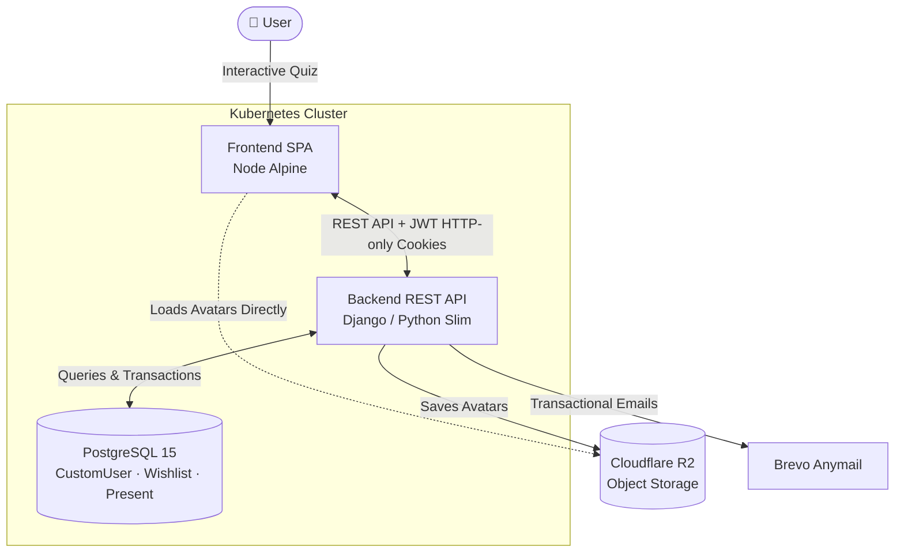

# 🏛 Giftly — System Architecture

The application architecture is divided into four logical layers, moving from business goals down to physical container orchestration.

## 📐 High-Level Architecture Diagram

---

## 🧱 Architectural Layers

### 1. Motivation & Business Layer
- **Primary User Goal:** Find a relevant, personalized gift in **under 2 minutes**.
- **Core Business Process:** Realized through the **Gift Recommendation Service**, which users access via the **Interactive Quiz** workflow.

### 2. Application & Data Layer
- **Frontend SPA:** Handles the interactive quiz UI, state management, and client-side routing. Communicates with the central backend node via HTTP requests.
- **Backend REST API:** Built on **Django**, serving as the central processing hub for filtering logic, user management, and external service integration.
- **Domain Data Model:** Built around three core related entities:
  - `CustomUser` — owns one or more wishlists.
  - `Wishlist` — groups saved gift ideas for a specific user.
  - `Present` — represents individual gift items aggregated within wishlists.
- **JWT Auth Service:** Dedicated authentication mechanism operating via **HTTP-only Cookies**. The backend implements the token lifecycle, validates credentials against the `CustomUser` table, and manages secure frontend authorization.

### 3. Technology Layer (External Integrations)
- **Cloudflare R2:** Object storage integrated with the backend for uploading and persisting user avatars, while the frontend fetches and renders images directly from the cloud CDN.
- **Brevo Anymail:** Transactional email provider connected to the backend for sending verification codes and password recovery emails.

### 4. Infrastructure & Storage Layer
- **Database:** The logical data model is physically implemented in **PostgreSQL 15**.
- **Containerization:** The entire stack is packaged into lightweight Docker images:
  - **Frontend:** `node:alpine`
  - **Backend:** `python:slim`
  - **Database:** Official `postgres:15` image
- **Orchestration:** All three Docker containers are deployed and orchestrated within a single **Kubernetes Cluster**.